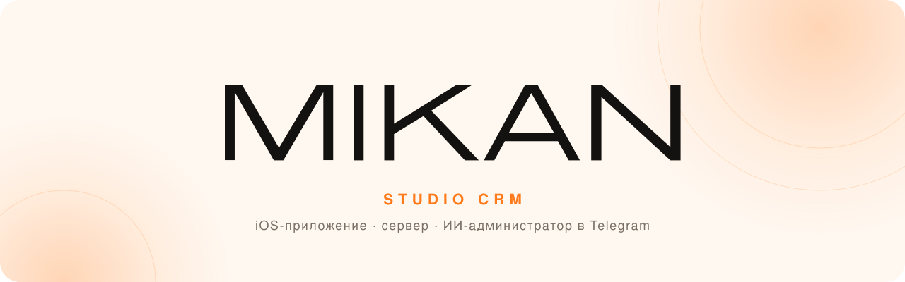
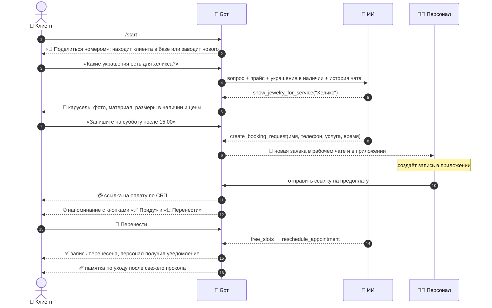
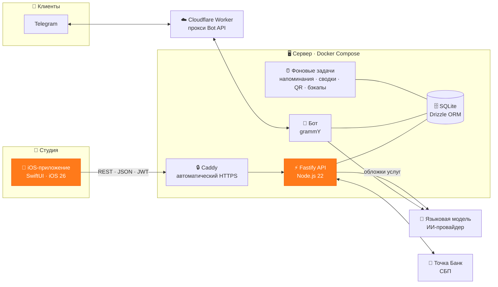

<div align="center">

<picture>
  <source media="(prefers-color-scheme: dark)" srcset="docs/assets/banner-dark.svg">
  
</picture>

<br>

**Вся студия в одном iPhone.** Запись, клиенты, касса, склад, предоплаты и отчёты в нативном приложении для персонала,<br>
а ИИ-администратор в Telegram отвечает клиентам круглосуточно и сам собирает заявки на запись.

<br>

[](#-стек)
[](#-стек)
[](#-стек)
[](#-стек)
[](#-стек)
[](#-стек)
<br>
[](#-ии-администратор-в-telegram)
[](#-ии-администратор-в-telegram)
[](#-под-капотом)
[](#-архитектура)
[](#-архитектура)

<br>

[Возможности](#-возможности) ·
[ИИ-бот](#-ии-администратор-в-telegram) ·
[Архитектура](#-архитектура) ·
[Стек](#-стек) ·
[API](docs/API.md) ·
[Контакты](#-стоимость-и-контакты)

</div>

---

## 🧭 Что это

**MIKAN STUDIO CRM** — система для тату- и пирсинг-студии, сделанная под ключ. Три части работают как одно целое:

| | Часть | Для кого | Что делает |
|:-:|---|---|---|
| 📱 | **iOS-приложение** | мастера и администраторы | расписание, клиенты, касса, украшения и склад, аналитика, переписка с клиентами |
| 🖥 | **Сервер** | всё остальное | REST API, база данных, фоновые задачи, оплата по СБП, бэкапы |
| 🤖 | **Telegram-бот с ИИ** | клиенты и сотрудники | консультирует, листает каталоги, принимает заявки, переносит записи, присылает напоминания и сводки дня |

<div align="center">

| 📏 **40 000+** | ⚙️ **16 500+** | 🔌 **95** | 🧪 **350+** | 🗂 **5** |
|:-:|:-:|:-:|:-:|:-:|
| строк Swift | строк TypeScript на сервере | эндпоинтов API | серверных тестов | разделов приложения |

</div>

---

## ✨ Возможности

<table>
<tr>
<td width="33%" valign="top">

### 📅 Запись
- Календарь по мастерам: день, 3 дня, неделя, месяц
- Сетка строится по рабочим часам студии, но записать можно на любое время
- Несколько услуг в одной записи, варианты и длительность
- Проверка пересечений в графике мастера
- Статусы: запланирована, подтверждена, завершена, отмена, неявка

</td>
<td width="33%" valign="top">

### 👥 Клиенты
- Карточка: имя, фамилия, телефон, день рождения, ник в Telegram, Instagram, заметки
- Полная история: услуги, покупки, возвраты
- Привязка Telegram по номеру телефона или ссылке-приглашению
- Поиск по имени, фамилии, цифрам телефона и никам
- Перенос базы и истории визитов из YCLIENTS

</td>
<td width="33%" valign="top">

### 💳 Касса
- Открытые чеки, общие для всех устройств: визит начинается прямо из записи
- Услуги, украшения с выбором размера и другие товары
- Наличные, перевод, **QR-код СБП** и смешанная оплата
- Предоплата засчитывается в чек автоматически
- Скидки, возвраты с возвратом на склад, кассовые смены

</td>
</tr>
<tr>
<td valign="top">

### 💎 Украшения
- Размеры с собственным остатком, ценой и артикулом
- Материал (титан ASTM F136, сталь 316L, золото…), тип резьбы, толщина, цвет, камень
- Несколько фото, поставщик, себестоимость
- Привязка к услугам: у каждого прокола свой список подходящих украшений
- Поиск и фильтры по категории, материалу и размеру

</td>
<td valign="top">

### 📦 Склад
- Единый склад: украшения, товары и расходники по категориям
- Приход с себестоимостью, списание, расход
- Ревизии с отчётом о недостачах и излишках
- Расходники можно вести как «есть / заканчивается / нет», без поштучного учёта
- Нормы расхода у услуг: расходники визита подставляются сами

</td>
<td valign="top">

### 💉 Услуги
- Каталог по категориям с обложками, которые рисует ИИ
- Варианты, цены «от», длительность, размер предоплаты
- Подходящие украшения и нормы расходников
- Памятки по уходу только для свежих проколов и тату
- Шаблоны памяток с расписанием по дням

</td>
</tr>
<tr>
<td valign="top">

### 💰 Предоплаты
- Журнал операций: внесение, зачёт, возврат, удержание
- Ссылка на оплату по СБП: на экране, в Telegram или обычной ссылкой
- Банк подтверждает оплату, и клиенту с персоналом сразу приходит сообщение
- Напоминание клиенту, если он ещё не оплатил

</td>
<td valign="top">

### 📈 Аналитика
- Выручка, себестоимость, прибыль и маржа
- Сравнение с прошлым периодом той же длины
- Графики по дням и способам оплаты
- Топ услуг и украшений, выручка по мастерам
- Новые клиенты, неявки и потери от них, экспорт в CSV

</td>
<td valign="top">

### 🔔 Напоминания
- Несколько напоминаний перед визитом по своему расписанию
- Кнопки «✅ Приду» и «🔁 Перенести» прямо в сообщении
- Памятки по уходу на нужные дни после процедуры
- Утренняя и вечерняя сводка для сотрудников в Telegram

</td>
</tr>
</table>

**А ещё:** база знаний для бота · сотрудники с цветами в календаре · счётчики непрочитанных чатов, новых заявок и низких остатков · ежедневные бэкапы базы.

---

## 🤖 ИИ-администратор в Telegram

Бот на базе **большой языковой модели** общается с клиентами просто и по-дружески. Он опирается только на данные студии: прайс, украшения в наличии, свободное время мастеров, базу знаний и записи самого клиента. Цены, наличие и свободные окна он не выдумывает.



**Для клиентов**
- 🧭 **Каталоги кнопками:** «💎 Украшения» и «💉 Услуги и цены» листаются каруселью и работают без обращения к ИИ
- 🔎 **Ищет украшения по описанию** («титановое кольцо 8 мм»): называет размеры в наличии и цены, но не количество на складе
- 📅 **Переносит записи:** видит свободное время мастеров в рабочие часы студии
- 🖼 **Видит фото:** клиент может прислать снимок прокола или украшения
- 🚑 **Осторожен со здоровьем:** при признаках осложнений сразу зовёт живого мастера
- 🙋 **Передаёт человеку** жалобы, отмены, сложные вопросы и просьбы позвать администратора

**Для сотрудников**
- 👩‍🎨 **Режим сотрудника:** бот узнаёт сотрудника по номеру и даёт свои кнопки: «Что сегодня», «Выручка за неделю», «Что заканчивается»
- ☀️ **Сводки дня:** утром план и всё, что требует внимания, вечером выручка и незакрытые дела. Собираются из базы, без затрат на ИИ
- 💬 **Чаты в приложении:** персонал отвечает клиенту из iPhone и может поставить ИИ на паузу в конкретном чате
- 🧪 **Песочница:** раздел «Проверить бота» прогоняет вопрос через ИИ, ничего не отправляя и не записывая
- 💸 **Лимиты расходов:** ответов в день и в час на один чат

---

## 🏗 Архитектура



### 🔩 Под капотом

| | |
|---|---|
| 🔁 **Идемпотентность** | Продажи, возвраты, касса, склад и предоплаты принимают `Idempotency-Key`: повторное нажатие или обрыв сети не проведут оплату дважды |
| 🪙 **Деньги в целых рублях** | Без копеек и плавающей точки. Продажа целиком проходит одной транзакцией |
| 🌍 **Часовой пояс студии** | «Сегодня», отчёты, напоминания и бэкапы считаются по поясу студии, а не сервера |
| 💾 **Бэкапы** | Ежедневная копия базы после 04:00, хранятся последние 14 |
| 🔐 **Безопасность** | JWT на 90 дней с отзывом при отключении сотрудника, bcrypt, лимит попыток входа |
| 🛡 **Прокси Telegram** | Cloudflare Worker пропускает только разрешённых ботов, открытым прокси он не станет |
| 🏦 **Сертификат Минцифры** | Корневому сертификату доверяют только запросы к Точке, остальные соединения сервера ему не доверяют |
| 📜 **Единый контракт** | [`docs/API.md`](docs/API.md) — один источник правды для сервера и приложения |

---

## 🧱 Стек

<table>
<tr><th>📱 iOS-приложение</th><th>🖥 Сервер</th><th>🔌 Интеграции и инфраструктура</th></tr>
<tr>
<td valign="top">

- Swift 6, строгая конкурентность
- SwiftUI, iOS 26, Liquid Glass
- `@Observable`-сторы
- Swift Charts для аналитики
- Keychain для токена
- XcodeGen (`project.yml`)
- XCTest и Swift Testing

</td>
<td valign="top">

- Node.js 22, TypeScript
- Fastify 5 + Zod
- SQLite (`better-sqlite3`) + Drizzle ORM
- grammY (Telegram Bot API)
- SDK языковой модели
- Luxon, Pino, Vitest

</td>
<td valign="top">

- Языковая модель для бота
- Генерация обложек услуг нейросетью
- СБП через API Точка Банка
- Docker Compose + Caddy
- Cloudflare Workers
- Импорт из YCLIENTS

</td>
</tr>
</table>

---

## 📂 Структура репозитория

```text
MIKAN/
├── ios/                      📱 SwiftUI-приложение для персонала
│   ├── MIKAN/App             вход, вкладки, состояние приложения
│   ├── MIKAN/Core            сеть, модели, дизайн-система, форматирование
│   ├── MIKAN/Features        Запись · Клиенты · Касса · Склад · Ещё
│   ├── MIKANTests            юнит-тесты
│   └── project.yml           описание проекта для XcodeGen
├── server/                   🖥 API + Telegram-бот
│   ├── src/routes            REST-эндпоинты
│   ├── src/domain            бизнес-логика: записи, продажи, касса, склад, предоплаты
│   ├── src/bot               бот: пайплайн, промпт, инструменты ИИ
│   ├── src/payments          СБП через Точку
│   ├── src/scripts           импорт из YCLIENTS, прайс-лист, настройка Точки
│   ├── drizzle/              миграции базы
│   └── test/                 тесты Vitest
├── deploy/                   🚀 docker-compose, Caddyfile, deploy.sh, инструкция
├── cloudflare/               ☁️ Worker-прокси для Telegram Bot API
└── docs/                     📜 контракт API, бренд
```

---

## 💼 Стоимость и контакты

<div align="center">

### Проект реализован под ключ за **270 000 ₽**

iOS-приложение, сервер, ИИ-бот в Telegram, оплата по СБП, деплой и перенос данных из YCLIENTS

<br>

Хотите такую же систему для своей студии или салона?

[](https://t.me/thiskai)

</div>

---

<div align="center">
<sub>Сделано с 🧡 для <b>MIKAN STUDIO</b></sub>
</div>
